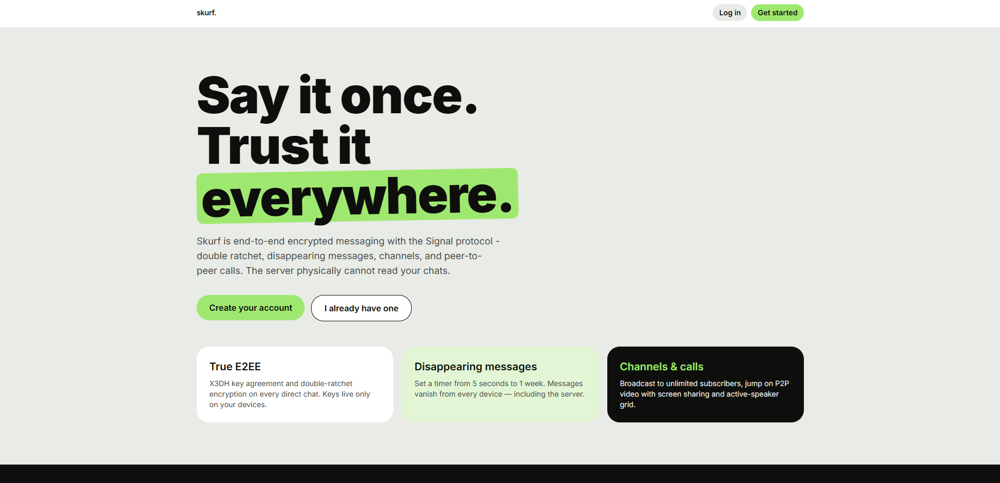
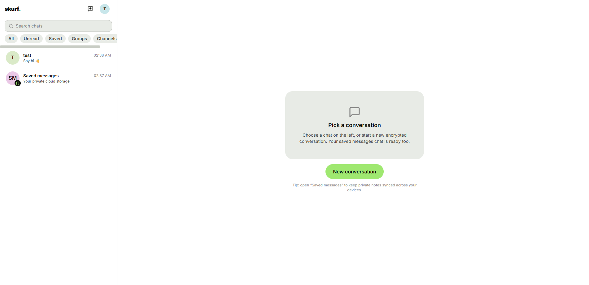
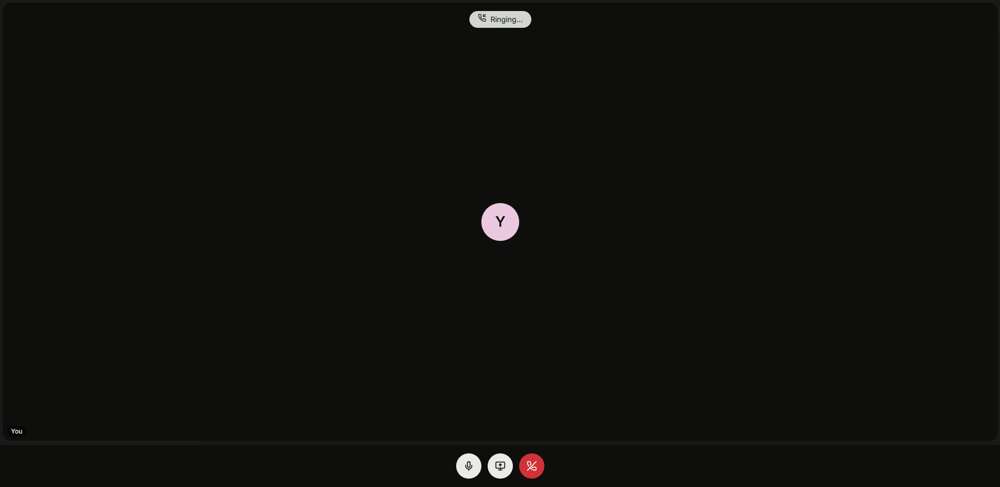
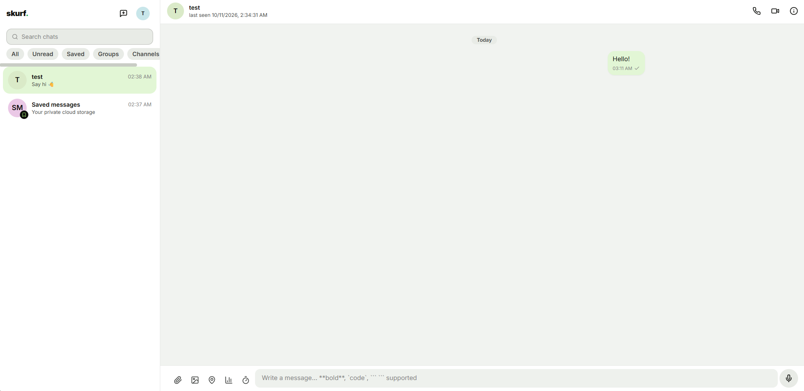
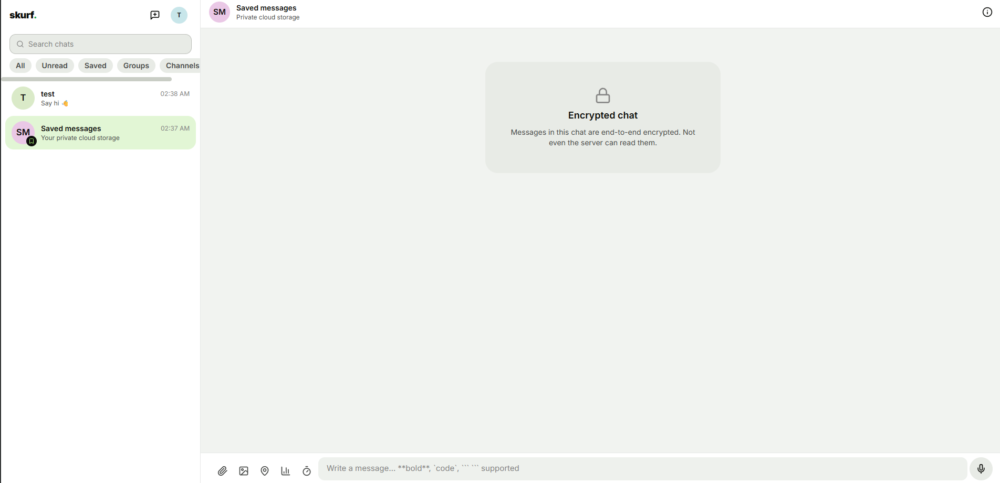

# Skurf

A high-performance, real-time hybrid P2P / client-server messaging platform combining the core features of WhatsApp, Telegram, and Signal - with genuine end-to-end encryption.

## Preview
 
 


## Stack

| Layer | Tech |
|---|---|
| Frontend / app | Next.js 14 (App Router), TypeScript, Tailwind CSS (Wise-inspired design system from `DESIGN.md`) |
| Realtime | Socket.io over a custom Node HTTP server, Redis pub/sub adapter (horizontal scale) |
| Database | PostgreSQL via Prisma |
| Cache / presence | Redis (online state, call rosters) |
| Local E2EE state | IndexedDB via Dexie.js (keys, ratchets, epochs never touch the server) |
| Crypto | TweetNaCl (X25519, Ed25519, XSalsa20) + WebCrypto (HKDF-SHA256, AES-GCM, PBKDF2) |
| Auth | JWT httpOnly session cookies + WebAuthn/passkeys |
| Calls | WebRTC P2P mesh (STUN/TURN via env config), screen sharing, active-speaker grid |

## Cryptographic design

- **Direct chats:** full Signal protocol - X3DH key agreement (identity keys, signed prekeys with Ed25519 signatures, one-time prekeys) followed by a per-device-pair **Double Ratchet**. The server stores only opaque per-device ciphertext envelopes; it cannot read any message payload.
- **Groups:** epoch-based group cipher (HKDF-derived AES-GCM keys per epoch, random nonce per message). Epoch seeds are distributed pairwise to every member device through the Double Ratchet control channel. Any membership change rotates the epoch, so removed members can't read new traffic. Any online member can answer `group:epoch-missing` requests with a pairwise epoch envelope.
- **Channels:** transport-encrypted (TLS) but *not* E2EE - identical to Telegram's channel model, since pairwise fan-out doesn't scale to unlimited subscribers.
- **Safety numbers:** SHA-256 over the sorted pair of X25519 identity keys, rendered as 12×5 digits (Signal style).
- **Multi-device:** every device has independent identity keys. Linking via QR (5-minute token) registers a new device bundle; history is intentionally not shared (Signal behavior).
- **App lock:** optional passcode (PBKDF2 310k iterations) that encrypts the local device key material in IndexedDB.

## Getting started

```bash
# 1. Infrastructure
docker compose up -d          # postgres + redis

# 2. Config
cp .env.example .env          # set JWT_SECRET to something random!

# 3. Install + schema
npm install
npm run db:push               # or: npm run db:migrate

# 4. Run
npm run dev                   # http://localhost:3000
```

Register two accounts in two different browser profiles, start a direct chat, and verify the safety number matches on both sides.

## Scripts

- `npm run dev` - dev server (Next + Socket.io via tsx)
- `npm run build` / `npm start` - production
- `npm test` - crypto protocol test suite (X3DH, Double Ratchet, group epochs, safety numbers, AEAD tamper resistance)
- `npm run typecheck` - strict TS check
- `npm run db:studio` - Prisma Studio

## Feature map

- **Messaging:** 1-1 / groups, markdown + code highlighting, sent/delivered/read ticks, replies, quick reactions, edit (15-min window), delete for everyone (24h) / for me, forwarding, typing indicators
- **Disappearing messages:** per-chat timer (5s → 1 week), enforced by server sweeper + client expiry
- **Media:** client-side image compression (canvas → WebP), voice notes with live waveform capture, documents, location sharing (static + live flag)
- **Channels:** public handles, owner/admin/subscriber roles, admin-only posting, unlimited subscribers, discovery search
- **Folders:** custom tabs (Work/Personal/Unread/…), chat assignment, pinned/archived
- **Polls:** single/multiple choice, anonymous mode, live tallies
- **Saved messages & cloud drafts:** self-chat + cross-device encrypted drafts
- **Calls:** 1-1 and group mesh calls, mute/camera/screen-share toggles, ringing lifecycle
- **Privacy:** last-seen visibility, read-receipt opt-out, passcode app lock, passkey login, device revocation

## Production notes

- Turn on TURN (`TURN_URL`, `TURN_USERNAME`, `TURN_CREDENTIAL`) - most NATs need it for calls.
- Swap disk media storage (`src/lib/storage.ts`) for S3-compatible storage.
- Group calls are mesh (fine ≤ ~6 participants); for larger rooms put an SFU (mediasoup/LiveKit) behind the existing `webrtc:signal` signaling.
- Rate-limit the REST routes and socket events at your ingress.
